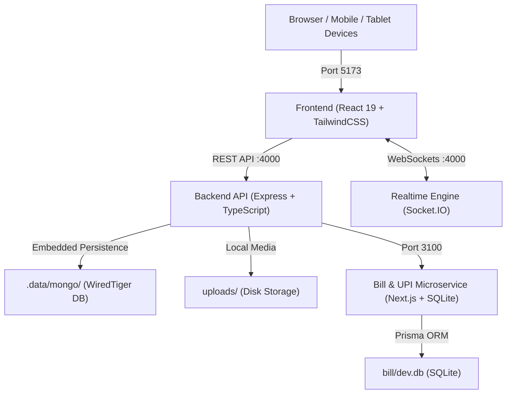

# SIZZLE — Enterprise Multi-Tenant Restaurant Operations Platform
## Comprehensive Technical Documentation & Client Handover Specification

---

## 1. Executive Summary

**Sizzle** is a full-stack, multi-tenant restaurant operations platform architected for modern hospitality businesses. It bridges the entire dining cycle into a unified, synchronized operating system:

1. **Guest Digital Experience**: Instant QR dining, table-side browsing, digital cart ordering, waiter paging, bill requests, and UPI/Cash settlement.
2. **Waiter & Floor Operations**: Visual floor map with table status color-coding, split bills, manual order creation, and service alerts.
3. **Kitchen Display System (KDS)**: Real-time ticket board with station-specific routing (Bar, Grill, Dessert, Main), elapsed timers, and bump actions.
4. **POS & Cashier Billing**: Bill splitting, tax calculation, discount codes, table transfer, receipt generation, and cash/UPI tracking.
5. **Owner & Manager Back Office**: Live gross sales analytics, inventory tracking with low-stock alerts, menu and recipe engineering, staff shift codes, and restaurant branding.

---

## 2. 100% Local Data Guarantee & Privacy

> **Enterprise Privacy Compliance**: Sizzle is engineered with **zero external cloud data dependencies**. All operational data, customer records, receipts, and media remain strictly within your local environment.

| Data Type | Storage Engine | Local Path / Location | Description |
| :--- | :--- | :--- | :--- |
| **Primary Database** | MongoDB (WiredTiger Engine) | `.data/mongo/` | Stores tenants, menus, orders, tables, audit logs, and users on the local machine disk. |
| **Billing & Payments** | SQLite Database | `bill/dev.db` | High-integrity local SQLite ledger for all bill computations and UPI payment logs. |
| **Uploaded Assets** | Local Filesystem | `uploads/` & `backend/uploads/` | Stores uploaded logos, food pictures, and cover banners on disk. |
| **Bills & Receipts** | Local Database & Thermal Print | Stored locally | Printed directly to local ESC/POS thermal printers and saved in history. |

---

## 3. System Architecture & Live Endpoints

The system operates across three coordinated tiers:



### Live URLs & Direct Port Mapping

| Service | Address | Default Port | Primary Purpose |
| :--- | :--- | :--- | :--- |
| **Frontend Web App** | `http://localhost:5173` | `5173` | Complete User Interface for Guests, Floor, Kitchen, Cashier & Owner. |
| **Backend REST & Realtime API** | `http://localhost:4000` | `4000` | Multi-tenant REST API, RBAC authentication, and Socket.IO real-time hub. |
| **UPI & Bill Generation Service** | `http://localhost:3100` | `3100` | Local billing calculation, UPI dynamic QR codes, and SQLite ledger. |

### Station & Workspace Direct Links

- **Main Sign-In**: [`http://localhost:5173/login`](http://localhost:5173/login) (One-click demo profiles + staff phone login)
- **New Store Onboarding**: [`http://localhost:5173/register`](http://localhost:5173/register) (2-step multi-tenant restaurant registration)
- **Owner Dashboard**: [`http://localhost:5173/app`](http://localhost:5173/app) (Full management suite)
- **Kitchen Display System (KDS)**: [`http://localhost:5173/kds`](http://localhost:5173/kds) (Station order queues)
- **Waiter Floor Map**: [`http://localhost:5173/floor`](http://localhost:5173/floor) (Active tables & order entry)
- **POS Cashier Bills**: [`http://localhost:5173/pos`](http://localhost:5173/pos) (Checkout & settlement)
- **Guest Dine-in Menu**: `http://localhost:5173/t/:tableToken` (Table-specific digital ordering)
- **Public Store App**: `http://localhost:5173/eat/:slug` (Customer takeaway & delivery app)

---

## 4. Complete Codebase & File Directory Dictionary

### 4.1 Frontend (`/frontend`)

The frontend is built using **React 19**, **TypeScript**, **Vite**, and **TailwindCSS**.

#### Root Files (`/frontend`)
- [`package.json`](file:///d:/New%20folder%20(2)/frontend/package.json): Defines frontend dependencies (`react`, `react-router-dom`, `zustand`, `lucide-react`, `socket.io-client`, `axios`, `jsqr`) and scripts.
- [`vite.config.ts`](file:///d:/New%20folder%20(2)/frontend/vite.config.ts): Vite build configurations and plugin definitions.
- [`tsconfig.json`](file:///d:/New%20folder%20(2)/frontend/tsconfig.json): TypeScript compiler options ensuring strict typing.

#### Core Application (`/frontend/src`)
- [`App.tsx`](file:///d:/New%20folder%20(2)/frontend/src/App.tsx): Master router configuring public guest pages, station layouts, and authenticated back-office routes.
- [`main.tsx`](file:///d:/New%20folder%20(2)/frontend/src/main.tsx): Client entry point initializing React DOM and global styles.
- [`index.css`](file:///d:/New%20folder%20(2)/frontend/src/index.css): Design system stylesheet with custom color tokens (ink, ember, leaf), typography, card styling, and animations.

#### Layouts (`/frontend/src/layouts`)
- [`AppShell.tsx`](file:///d:/New%20folder%20(2)/frontend/src/layouts/AppShell.tsx): Common branding header and navigation shell used across apps.
- [`StaffLayout.tsx`](file:///d:/New%20folder%20(2)/frontend/src/layouts/StaffLayout.tsx): Layout for the Owner/Manager Back Office, including sidebar navigation, tenant indicator, and quick links.
- [`FloorLayout.tsx`](file:///d:/New%20folder%20(2)/frontend/src/layouts/FloorLayout.tsx): Specialized full-height mobile-first shell for Waiters on the restaurant floor.
- [`KdsLayout.tsx`](file:///d:/New%20folder%20(2)/frontend/src/layouts/KdsLayout.tsx): High-contrast dark-mode shell for kitchen screens with audio chimes and station filtering.
- [`PosLayout.tsx`](file:///d:/New%20folder%20(2)/frontend/src/layouts/PosLayout.tsx): Layout for Cashier and billing counters with split-screen bills and settlement queues.

#### UI Components (`/frontend/src/components`)
- [`ui.tsx`](file:///d:/New%20folder%20(2)/frontend/src/components/ui.tsx): Core component library (`Button`, `Input`, `Field`, `Select`, `Textarea`, `Modal`, `Card`, `Badge`, `Spinner`, `Toggle`, `SegmentedControl`).
- [`charts.tsx`](file:///d:/New%20folder%20(2)/frontend/src/components/charts.tsx): Custom SVG-based analytics components (Donut charts, Bar charts, Area sparklines, and metric cards).
- [`ImagePicker.tsx`](file:///d:/New%20folder%20(2)/frontend/src/components/ImagePicker.tsx): Universal image upload component supporting disk storage, camera capture, live preview, and public upload endpoints.
- [`Toaster.tsx`](file:///d:/New%20folder%20(2)/frontend/src/components/Toaster.tsx): Global notification toaster rendering real-time success, warning, and error alerts.
- [`OperationsAppModal.tsx`](file:///d:/New%20folder%20(2)/frontend/src/components/OperationsAppModal.tsx): Interactive helper modal displaying station links, QR codes, and system shortcuts.
- [`ClerkAuthBridge.tsx`](file:///d:/New%20folder%20(2)/frontend/src/components/ClerkAuthBridge.tsx): Optional authentication bridge supporting enterprise SSO.

#### State & Realtime Stores (`/frontend/src/store` & `/frontend/src/hooks`)
- [`store/auth.ts`](file:///d:/New%20folder%20(2)/frontend/src/store/auth.ts): Zustand store managing JWT tokens, active user session, restaurant metadata, login, and registration.
- [`store/toasts.ts`](file:///d:/New%20folder%20(2)/frontend/src/store/toasts.ts): Global notification message state manager.
- [`hooks/useRealtimeShell.ts`](file:///d:/New%20folder%20(2)/frontend/src/hooks/useRealtimeShell.ts): Hook binding global WebSockets for order sound notifications and status updates.

#### Utilities & Client Libraries (`/frontend/src/lib`)
- [`lib/api.ts`](file:///d:/New%20folder%20(2)/frontend/src/lib/api.ts): Axios HTTP client with automatic JWT token attachment, 401 refresh interceptors, and error formatters.
- [`lib/socket.ts`](file:///d:/New%20folder%20(2)/frontend/src/lib/socket.ts): Socket.IO client handling bi-directional real-time communication.
- [`lib/types.ts`](file:///d:/New%20folder%20(2)/frontend/src/lib/types.ts): Comprehensive TypeScript interfaces for all backend models, orders, and roles.
- [`lib/format.ts`](file:///d:/New%20folder%20(2)/frontend/src/lib/format.ts): Currency formatters (₹ INR), date-time helpers, and string transformers.
- [`lib/downloadQr.ts`](file:///d:/New%20folder%20(2)/frontend/src/lib/downloadQr.ts): Helper for generating and downloading high-resolution PNG QR codes for tables and counters.
- [`lib/jobs.ts`](file:///d:/New%20folder%20(2)/frontend/src/lib/jobs.ts): Role descriptions and station definitions for floor staff.
- [`lib/demoAccounts.ts`](file:///d:/New%20folder%20(2)/frontend/src/lib/demoAccounts.ts): Seed credentials for one-click testing across roles.
- [`lib/statusMaps.ts`](file:///d:/New%20folder%20(2)/frontend/src/lib/statusMaps.ts): UI badge color maps for orders, payments, and table states.
- [`lib/query.ts`](file:///d:/New%20folder%20(2)/frontend/src/lib/query.ts): Lightweight asynchronous data-fetching helper.

#### Pages (`/frontend/src/pages`)
- **Public & Authentication**:
  - [`Login.tsx`](file:///d:/New%20folder%20(2)/frontend/src/pages/Login.tsx): Station login with password, phone OTP, and 1-tap demo credentials.
  - [`Register.tsx`](file:///d:/New%20folder%20(2)/frontend/src/pages/Register.tsx): 2-step onboarding wizard for new restaurant owners (branding, logo, address, owner account).
  - [`Hub.tsx`](file:///d:/New%20folder%20(2)/frontend/src/pages/Hub.tsx): Landing portal navigating to all stations, demo accounts, and guest views.
  - [`StaffInstall.tsx`](file:///d:/New%20folder%20(2)/frontend/src/pages/StaffInstall.tsx): PWA installation landing screen for restaurant floor tablets and phones.
  - [`ApplyJob.tsx`](file:///d:/New%20folder%20(2)/frontend/src/pages/ApplyJob.tsx): Public job application screen scanned from restaurant recruitment QR codes.
  - [`NotFound.tsx`](file:///d:/New%20folder%20(2)/frontend/src/pages/NotFound.tsx): Clean 404 error page.

- **Owner & Back Office Suite (`/frontend/src/pages/owner`)**:
  - [`DashboardPage.tsx`](file:///d:/New%20folder%20(2)/frontend/src/pages/owner/DashboardPage.tsx): Executive overview displaying today's gross revenue, active orders, live table occupancy, and top items.
  - [`OrdersPage.tsx`](file:///d:/New%20folder%20(2)/frontend/src/pages/owner/OrdersPage.tsx): Searchable, filterable list of all orders across dine-in, takeaway, and delivery.
  - [`OrderDetailPage.tsx`](file:///d:/New%20folder%20(2)/frontend/src/pages/owner/OrderDetailPage.tsx): Deep inspection of order timeline, items, customer details, and bill breakdown.
  - [`TablesPage.tsx`](file:///d:/New%20folder%20(2)/frontend/src/pages/owner/TablesPage.tsx): Table manager: add tables, assign sections, set capacity, and export QR stickers.
  - [`MenuPage.tsx`](file:///d:/New%20folder%20(2)/frontend/src/pages/owner/MenuPage.tsx): Menu editor: categories, dish pricing, photos, modifiers, allergens, and inventory links.
  - [`BookingsPage.tsx`](file:///d:/New%20folder%20(2)/frontend/src/pages/owner/BookingsPage.tsx): Table reservation book: manage guest bookings, slot times, and seating confirmation.
  - [`InventoryPage.tsx`](file:///d:/New%20folder%20(2)/frontend/src/pages/owner/InventoryPage.tsx): Stock ledger: ingredients, par levels, unit costs, and manual restock logging.
  - [`StaffPage.tsx`](file:///d:/New%20folder%20(2)/frontend/src/pages/owner/StaffPage.tsx): Team roster: add staff members, manage roles (Waiter, Chef, Cashier), and review applicants.
  - [`ReportsPage.tsx`](file:///d:/New%20folder%20(2)/frontend/src/pages/owner/ReportsPage.tsx): Financial & operational reports: revenue trends, payment splits, average order value, and hourly heatmaps.
  - [`PaymentsPage.tsx`](file:///d:/New%20folder%20(2)/frontend/src/pages/owner/PaymentsPage.tsx): Payment tracking: UPI settlements, cash collections, and payment verification.
  - [`DeliveryPage.tsx`](file:///d:/New%20folder%20(2)/frontend/src/pages/owner/DeliveryPage.tsx): Manage direct takeaway, delivery orders, and third-party delivery configurations.
  - [`AuditPage.tsx`](file:///d:/New%20folder%20(2)/frontend/src/pages/owner/AuditPage.tsx): Security audit trail: immutable log of menu edits, discounts, voids, and staff logins.
  - [`SettingsPage.tsx`](file:///d:/New%20folder%20(2)/frontend/src/pages/owner/SettingsPage.tsx): Store configuration: restaurant name, logo, GST tax percent, service charge, UPI ID, and opening hours.

- **Kitchen Station (`/frontend/src/pages/kitchen`)**:
  - [`KdsBoard.tsx`](file:///d:/New%20folder%20(2)/frontend/src/pages/kitchen/KdsBoard.tsx): Kitchen Display System board showing incoming orders, recipe notes, preparation timers, and bump buttons.

- **Waiter Station (`/frontend/src/pages/waiter`)**:
  - [`WaiterFloor.tsx`](file:///d:/New%20folder%20(2)/frontend/src/pages/waiter/WaiterFloor.tsx): Mobile waiter dashboard with table cards, active sessions, and guest calls.
  - [`FloorMap.tsx`](file:///d:/New%20folder%20(2)/frontend/src/pages/waiter/FloorMap.tsx): Visual 2D floor layout displaying available, seated, ordered, and billing tables.
  - [`NewOrder.tsx`](file:///d:/New%20folder%20(2)/frontend/src/pages/waiter/NewOrder.tsx): Table-side ordering terminal for waiters to punch orders directly to the kitchen.

- **POS / Billing Station (`/frontend/src/pages/pos`)**:
  - [`BillsPage.tsx`](file:///d:/New%20folder%20(2)/frontend/src/pages/pos/BillsPage.tsx): Cashier register for bill settlement, applying discounts, accepting cash/UPI, and printing receipts.
  - [`PosRequests.tsx`](file:///d:/New%20folder%20(2)/frontend/src/pages/pos/PosRequests.tsx): Real-time queue of guest requests (water, cutlery, bill, assistance).

- **Guest Digital Experience (`/frontend/src/pages/guest`)**:
  - [`GuestMenu.tsx`](file:///d:/New%20folder%20(2)/frontend/src/pages/guest/GuestMenu.tsx): Digital interactive menu opened by scanning table QR codes.
  - [`GuestSession.tsx`](file:///d:/New%20folder%20(2)/frontend/src/pages/guest/GuestSession.tsx): Active dine-in session showing placed orders, preparation status, and cumulative total.
  - [`GuestBill.tsx`](file:///d:/New%20folder%20(2)/frontend/src/pages/guest/GuestBill.tsx): Digital bill view with itemized charges, GST breakdown, and instant UPI QR pay.
  - [`PublicBooking.tsx`](file:///d:/New%20folder%20(2)/frontend/src/pages/guest/PublicBooking.tsx): Guest-facing online table reservation screen.

- **Online Ordering App (`/frontend/src/pages/app`)**:
  - [`AppLanding.tsx`](file:///d:/New%20folder%20(2)/frontend/src/pages/app/AppLanding.tsx): Customer ordering landing portal.
  - [`CustomerApp.tsx`](file:///d:/New%20folder%20(2)/frontend/src/pages/app/CustomerApp.tsx): Full digital delivery and takeaway web shop for the restaurant.
  - [`AppTrack.tsx`](file:///d:/New%20folder%20(2)/frontend/src/pages/app/AppTrack.tsx): Live order tracker for takeaway and delivery orders.
  - [`MockCheckout.tsx`](file:///d:/New%20folder%20(2)/frontend/src/pages/app/MockCheckout.tsx): Simulated payment gateway verification.

---

### 4.2 Backend API & Real-time Server (`/backend`)

The backend is built with **Node.js**, **Express**, **TypeScript**, **Mongoose (MongoDB)**, and **Socket.IO**.

#### Server Entry & Configuration (`/backend/src`)
- [`server.ts`](file:///d:/New%20folder%20(2)/backend/src/server.ts): Main process bootstrap: connects to local MongoDB, auto-seeds demo data if empty, attaches Socket.IO, starts the background scheduler, and handles graceful shutdown.
- [`app.ts`](file:///d:/New%20folder%20(2)/backend/src/app.ts): Express application assembly: registers security headers (`helmet`), CORS, JSON body parsers, cookie parsers, audit logging, and routing.
- [`routes.ts`](file:///d:/New%20folder%20(2)/backend/src/routes.ts): Master API router mounting all modular domain endpoints.
- [`seed.ts`](file:///d:/New%20folder%20(2)/backend/src/seed.ts): Seed engine generating the complete demo restaurant (*Saffron & Smoke*), starter menu items, ingredients, tables, historical sales, and staff.
- [`config/env.ts`](file:///d:/New%20folder%20(2)/backend/src/config/env.ts): Strongly typed environment variable validator and secret loader.
- [`config/db.ts`](file:///d:/New%20folder%20(2)/backend/src/config/db.ts): High-reliability MongoDB connector. If no cloud URI is given, it automatically launches an embedded MongoDB server with **WiredTiger engine on local disk (`.data/mongo/`)**.

#### Middleware (`/backend/src/middleware`)
- [`auth.ts`](file:///d:/New%20folder%20(2)/backend/src/middleware/auth.ts): JWT verification middleware extracting user ID, tenant ID, and permissions into `req.auth`.
- [`rbac.ts`](file:///d:/New%20folder%20(2)/backend/src/middleware/rbac.ts): Role-Based Access Control enforcing permissions (`menu:write`, `settings:write`, `reports:read`, etc.).
- [`error.ts`](file:///d:/New%20folder%20(2)/backend/src/middleware/error.ts): Centralized error handler capturing Zod validation errors, Mongoose duplicates, and HTTP exceptions.
- [`rateLimit.ts`](file:///d:/New%20folder%20(2)/backend/src/middleware/rateLimit.ts): Rate limiting protecting login, OTP endpoints, and public upload routes from abuse.
- [`upload.ts`](file:///d:/New%20folder%20(2)/backend/src/middleware/upload.ts): Multer disk-storage pipeline validating image MIME types and saving files to the local `uploads/` folder.
- [`validate.ts`](file:///d:/New%20folder%20(2)/backend/src/middleware/validate.ts): Zod request validator validating `body`, `query`, and `params`.

#### Database Models (`/backend/src/models`)
- [`Restaurant.ts`](file:///d:/New%20folder%20(2)/backend/src/models/Restaurant.ts): Multi-tenant restaurant entity: name, slug, address, tax percent, service charge, branding, hours, and UPI details.
- [`User.ts`](file:///d:/New%20folder%20(2)/backend/src/models/User.ts): User accounts: name, email, phone, role (`OWNER`, `MANAGER`, `WAITER`, `KITCHEN`, `CASHIER`), hashed passwords, and session tokens.
- [`Table.ts`](file:///d:/New%20folder%20(2)/backend/src/models/Table.ts): Restaurant table schema: number, capacity, section, status (`AVAILABLE`, `SEATED`, `ORDERED`, `BILLING`), and unique `qrToken`.
- [`TableSession.ts`](file:///d:/New%20folder%20(2)/backend/src/models/TableSession.ts): Active dining session representing a seated party at a table.
- [`Order.ts`](file:///d:/New%20folder%20(2)/backend/src/models/Order.ts): Master order record: items, notes, status (`RECEIVED`, `CONFIRMED`, `PREPARING`, `READY`, `SERVED`, `COMPLETED`, `CANCELLED`), table reference, and prices.
- [`Bill.ts`](file:///d:/New%20folder%20(2)/backend/src/models/Bill.ts): Final bill record: subtotal, taxes, service charges, discounts, rounding, and payment status.
- [`Payment.ts`](file:///d:/New%20folder%20(2)/backend/src/models/Payment.ts): Individual payment transaction (Cash, UPI, Card) linked to a bill.
- [`Category.ts`](file:///d:/New%20folder%20(2)/backend/src/models/Category.ts): Menu categories with display sort order.
- [`Product.ts`](file:///d:/New%20folder%20(2)/backend/src/models/Product.ts): Menu dishes: title, price, description, image, station (`KITCHEN`, `BAR`, `GRILL`, `DESSERT`), and recipe ingredients.
- [`Addon.ts`](file:///d:/New%20folder%20(2)/backend/src/models/Addon.ts): Modifiers and add-ons (extra cheese, spice levels, sides).
- [`Booking.ts`](file:///d:/New%20folder%20(2)/backend/src/models/Booking.ts): Advance table reservations with guest count and time slots.
- [`InventoryItem.ts`](file:///d:/New%20folder%20(2)/backend/src/models/InventoryItem.ts): Raw ingredients: current stock, par levels, reorder threshold, and unit cost.
- [`InventoryTransaction.ts`](file:///d:/New%20folder%20(2)/backend/src/models/InventoryTransaction.ts): Stock ledger recording ingredient deductions from completed orders or manual adjustments.
- [`CustomerRequest.ts`](file:///d:/New%20folder%20(2)/backend/src/models/CustomerRequest.ts): Service calls from table QR codes (Water, Cutlery, Waiter, Bill).
- [`Notification.ts`](file:///d:/New%20folder%20(2)/backend/src/models/Notification.ts): Staff notifications dispatched during orders and alerts.
- [`AuditLog.ts`](file:///d:/New%20folder%20(2)/backend/src/models/AuditLog.ts): Immutable activity log recording system changes and logins.
- [`Counter.ts`](file:///d:/New%20folder%20(2)/backend/src/models/Counter.ts): Sequential atomic counters for daily bill and order numbers.
- [`StaffApplication.ts`](file:///d:/New%20folder%20(2)/backend/src/models/StaffApplication.ts): Job applications received from the public hiring screen.
- [`LoginCode.ts`](file:///d:/New%20folder%20(2)/backend/src/models/LoginCode.ts): Short-lived 5-minute floor sign-in OTP codes.

#### Modules & API Endpoints (`/backend/src/modules`)
- [`auth/`](file:///d:/New%20folder%20(2)/backend/src/modules/auth):
  - `auth.routes.ts` & `auth.service.ts`: Tenant registration (`/register`), owner & staff sign-in (`/login`), session refresh, and password change.
  - `otp.service.ts`: SMS/Phone login codes for floor staff without passwords.
- [`restaurants/`](file:///d:/New%20folder%20(2)/backend/src/modules/restaurants):
  - `restaurant.routes.ts`: Update store profile, branding, taxes, opening hours, and generate staff/customer QR stickers.
- [`tables/`](file:///d:/New%20folder%20(2)/backend/src/modules/tables):
  - `table.routes.ts`: Manage tables, generate individual table QR codes, open/close dining sessions, and query real-time table statuses.
- [`menu/`](file:///d:/New%20folder%20(2)/backend/src/modules/menu):
  - `menu.routes.ts`: CRUD for categories, products, modifiers, recipe attachments, and availability toggles.
- [`orders/`](file:///d:/New%20folder%20(2)/backend/src/modules/orders):
  - `order.routes.ts`: Order creation from QR or Waiter terminals, status transitions, item additions, and order cancellation.
- [`billing/`](file:///d:/New%20folder%20(2)/backend/src/modules/billing):
  - `billing.routes.ts`: Generate bills from table orders, apply split bills, apply discounts, and complete table checkout.
- [`payments/`](file:///d:/New%20folder%20(2)/backend/src/modules/payments):
  - `payments.routes.ts`: Record cash and UPI payments against open bills.
  - `billService.routes.ts`: Bridge with the local Next.js / SQLite billing microservice.
- [`inventory/`](file:///d:/New%20folder%20(2)/backend/src/modules/inventory):
  - `inventory.routes.ts`: Track stock levels, log restock purchases, view ingredient depletion, and alert on low stock.
- [`kitchen/`](file:///d:/New%20folder%20(2)/backend/src/modules/kitchen):
  - `kitchen.routes.ts`: KDS endpoints for fetching active tickets, filtering by station, and bumping order states.
- [`waiters/`](file:///d:/New%20folder%20(2)/backend/src/modules/waiters):
  - `waiters.routes.ts`: Floor operations, table assignments, and guest assistance calls.
- [`bookings/`](file:///d:/New%20folder%20(2)/backend/src/modules/bookings):
  - `booking.routes.ts`: Guest reservation slots, confirmation, and seating conversion.
- [`staff/`](file:///d:/New%20folder%20(2)/backend/src/modules/staff):
  - `staff.routes.ts`: Staff roster management, hiring approvals, and role updates.
- [`reports/`](file:///d:/New%20folder%20(2)/backend/src/modules/reports):
  - `report.routes.ts`: Analytics engine delivering sales totals, category shares, payment method breakdowns, and tax summaries.
- [`uploads/`](file:///d:/New%20folder%20(2)/backend/src/modules/uploads):
  - `uploads.routes.ts`: Authenticated and public image upload handlers saving files locally.
- [`audit/`](file:///d:/New%20folder%20(2)/backend/src/modules/audit):
  - `audit.routes.ts`: Query audit logs for managerial review.

#### Realtime Engine (`/backend/src/realtime`)
- [`socket.ts`](file:///d:/New%20folder%20(2)/backend/src/realtime/socket.ts): Socket.IO server initialization with JWT authentication and tenant-based room isolation (`restaurant:<id>`).
- [`emit.ts`](file:///d:/New%20folder%20(2)/backend/src/realtime/emit.ts): Typed event dispatchers (`ORDER_CREATED`, `ORDER_STATUS_CHANGED`, `TABLE_UPDATED`, `BILL_REQUESTED`, `ASSISTANCE_REQUESTED`).

#### Core Business Logic Services (`/backend/src/services`)
- [`order.service.ts`](file:///d:/New%20folder%20(2)/backend/src/services/order.service.ts): Order creation, recipe ingredient deduction, and status transitions.
- [`billing.service.ts`](file:///d:/New%20folder%20(2)/backend/src/services/billing.service.ts): Tax, service charge, and discount calculations with sequential bill numbers.
- [`pricing.service.ts`](file:///d:/New%20folder%20(2)/backend/src/services/pricing.service.ts): Item pricing computation including modifier addons.
- [`table.service.ts`](file:///d:/New%20folder%20(2)/backend/src/services/table.service.ts): Session state machine and table availability rules.
- [`inventory.service.ts`](file:///d:/New%20folder%20(2)/backend/src/services/inventory.service.ts): Stock decrement logic based on dish recipe components.
- [`notification.service.ts`](file:///d:/New%20folder%20(2)/backend/src/services/notification.service.ts): Alert dispatching to staff screens.
- [`report.service.ts`](file:///d:/New%20folder%20(2)/backend/src/services/report.service.ts): Analytical aggregations for revenue, tax, and sales history.
- [`audit.service.ts`](file:///d:/New%20folder%20(2)/backend/src/services/audit.service.ts): Immutable audit log writer.
- [`scheduler.service.ts`](file:///d:/New%20folder%20(2)/backend/src/services/scheduler.service.ts): Background cron tasks for reservation reminders and cleanup.

---

### 4.3 Billing & UPI Microservice (`/bill`)

A high-performance microservice using **Next.js (App Router)**, **SQLite**, and **Prisma ORM**.

#### Key Files (`/bill`)
- [`package.json`](file:///d:/New%20folder%20(2)/bill/package.json): Defines dependencies (`@prisma/client`, `better-sqlite3`, `qrcode`, `next`).
- [`prisma/schema.prisma`](file:///d:/New%20folder%20(2)/bill/prisma/schema.prisma): SQLite schema modeling bills, line items, and UPI payment intents.
- `dev.db`: The local SQLite database file storing bill calculations and UPI transaction records.
- `src/`: Next.js endpoints serving dynamic UPI QR codes and receipt verification.

---

## 5. Role-Based Access Control & Security Model

The system enforces strict permission boundaries between owners, staff, and dining customers:

```
┌────────────────────────────────────────────────────────┐
│                   System Roles & Access                │
├───────────────┬────────────────────────────────────────┤
│ OWNER         │ Total back-office control, finance,    │
│               │ menus, staff hiring, and store profile │
├───────────────┼────────────────────────────────────────┤
│ MANAGER       │ Floor operations, table edits, orders, │
│               │ discounts, and staff shift review      │
├───────────────┼────────────────────────────────────────┤
│ CASHIER       │ Bills, split payments, settlements,    │
│               │ cash ledger, and receipt printing      │
├───────────────┼────────────────────────────────────────┤
│ WAITER        │ Visual floor map, punching orders,     │
│               │ and answering guest table calls        │
├───────────────┼────────────────────────────────────────┤
│ KITCHEN       │ KDS station tickets, cook timers, and  │
│               │ bumping completed dishes               │
├───────────────┼────────────────────────────────────────┤
│ GUEST         │ Digital menu, placing order to cart,   │
│ (Customer)    │ call waiter, view bill, and UPI pay.   │
│               │ STRICTLY NO ACCESS TO DASHBOARDS.      │
└───────────────┴────────────────────────────────────────┘
```

---

## 6. Deployment & Running Guide

### 6.1 Prerequisites
- **Node.js**: Version 20 or higher
- **Operating System**: Windows / Linux / macOS (all cross-compatible)
- **Zero Cloud Setup Required**: Pre-configured with local databases.

### 6.2 Starting the Platform Locally

Open two terminal windows:

**Terminal 1 — Backend API & Local Database**:
```bash
cd backend
npm run dev
# Server ready on http://localhost:4000
```

**Terminal 2 — Frontend Application**:
```bash
cd frontend
npm run dev
# Frontend ready on http://localhost:5173
```

*(Optional) Terminal 3 — Dedicated Billing Microservice*:
```bash
cd bill
npm run dev
# Billing service ready on http://localhost:3100
```

---

## 7. Deliverables & Verification Checklist

- [x] **Multi-Tenant Onboarding**: New owners can register custom restaurants with logos and addresses.
- [x] **Customer Privacy**: Guests are strictly confined to public QR routes; management dashboards are locked behind JWT authentication.
- [x] **100% Local Persistence**: Verified WiredTiger `.data/mongo/` and SQLite `bill/dev.db` storage.
- [x] **Production Type Safety**: Both backend and frontend compile with zero TypeScript errors.
- [x] **Client Documentation**: Delivered in this comprehensive, handover-ready specification.
